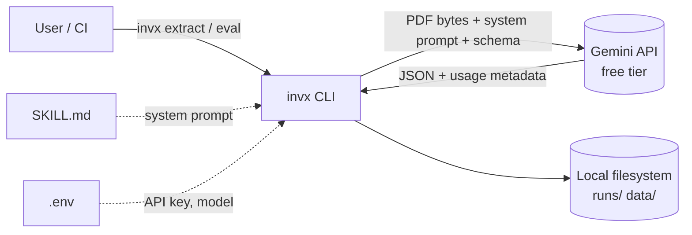
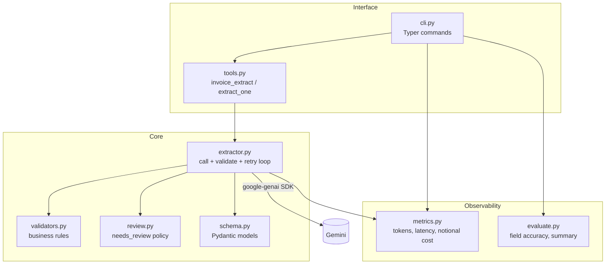
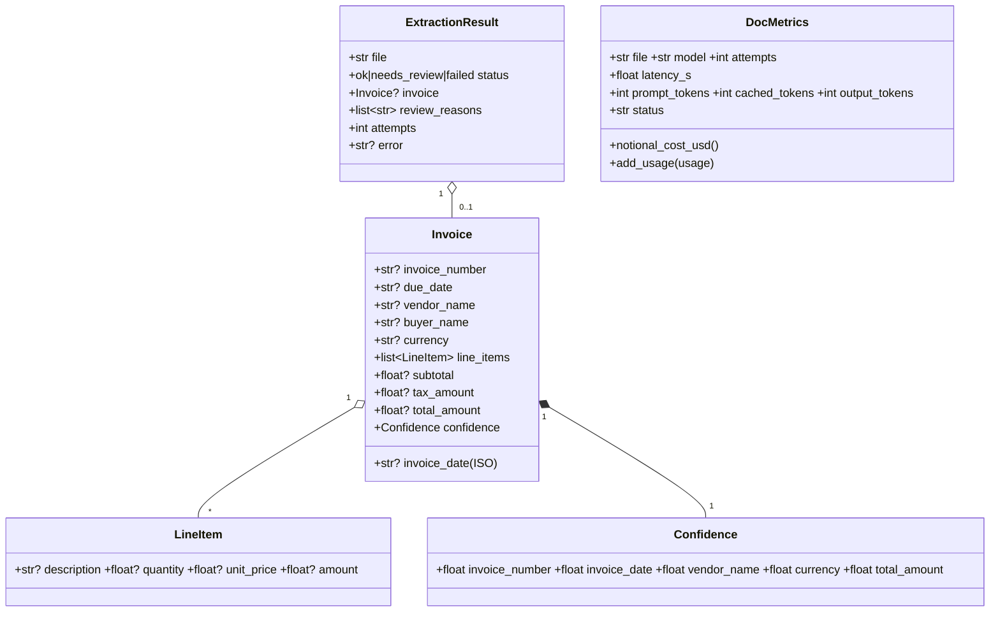
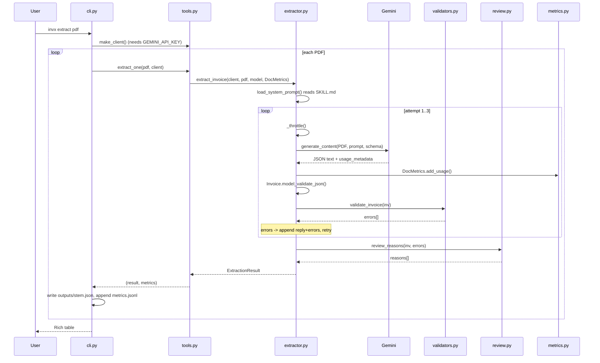
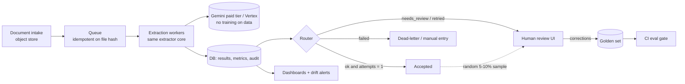

# invx — Design (HLD, LLD, data & control flow)

Describes the code as built (`src/invx/`). Section 6 covers the target production shape, which is **not built yet**.

---

## 1. High-Level Design (HLD)

### 1.1 Purpose and scope
A CLI that turns invoice PDFs into validated JSON using Gemini's native PDF input, retries when validation fails, and flags uncertain documents as `needs_review` instead of guessing. Cost, tokens and latency are logged per document. Synthetic/public documents only.

### 1.2 Context



### 1.3 Logical architecture



### 1.4 Key decisions

| Decision | Why | Trade-off |
|---|---|---|
| Send PDF bytes directly to Gemini | No OCR/layout pipeline; model reads text, tables and scans | Model cost and rate limits; no bounding-box provenance |
| Structured output (`response_schema=Invoice`) **and** Pydantic re-validation | Schema constrains the shape; Pydantic + business rules catch wrong *values* | Schema constraints do not guarantee arithmetic correctness |
| Validation error fed back to model (max 2 retries) | Cheap self-correction for misreads | Extra latency/tokens; cannot fix a document that is itself inconsistent |
| `null` + confidence over guessing, then `needs_review` | In BFSI a wrong value is worse than a missing one | More human review |
| Instructions in `SKILL.md`, loaded at runtime | Single source of truth, portable as an Agent Skill | Path coupling to repo layout |
| Implicit caching (stable prompt prefix) + notional cost | Free tier has no billing/explicit caching | Cost figures are estimates; cache hits likely ~0 (prompt is small) |
| File-based persistence (JSON/JSONL) | Simple, inspectable, no infra | No concurrency, querying or retention controls |

### 1.5 Non-functional view

| Concern | Current handling |
|---|---|
| Rate limits | Global min gap between calls (`INVX_MIN_INTERVAL`, 6.5 s); backoff on 429/503 (15, 30, 60, 120 s) |
| Failure isolation | Any exception per document returns `status=failed`; the batch continues |
| Observability | `metrics.jsonl` per document; Rich table; `results.json` for eval |
| Security / data | `.env` git-ignored; synthetic data only; no PII logging yet (raw model output is not logged) |
| Determinism | `temperature=0`; seeded data generator |
| Testability | Gemini client injected into `extract_invoice`; fake client in tests |

---

## 2. Low-Level Design (LLD)

### 2.1 Module responsibilities

| File | Responsibility | Key symbols |
|---|---|---|
| `cli.py` | Commands, batch loop, output files, tables | `extract`, `eval_cmd`, `_run`, `_results_table` |
| `tools.py` | Agent-facing tool + object-returning twin; client factory | `TOOL_SPEC`, `invoice_extract`, `extract_one`, `make_client` |
| `extractor.py` | Gemini call, validate/retry loop, throttling | `extract_invoice`, `_generate`, `_throttle`, `load_system_prompt` |
| `schema.py` | Data contracts | `Invoice`, `LineItem`, `Confidence`, `ExtractionResult`, `REQUIRED_FIELDS` |
| `validators.py` | Pure business rules returning error strings | `validate_invoice`, `check_dates/currency/line_items/totals` |
| `review.py` | Decide `needs_review` and reasons | `review_reasons` |
| `metrics.py` | Token/latency accounting, notional cost, JSONL append | `DocMetrics`, `RATES`, `append_jsonl` |
| `evaluate.py` | Per-field scoring, run summary | `score_doc`, `summarize`, `FIELDS` |
| `scripts/gen_synthetic.py` | Synthetic PDFs + labels | `build_truth`, `apply_defect`, `render` |

### 2.2 Class / data model



`DocMetrics` is accumulated *across all attempts* for a document, so retries show up as higher tokens and cost.

### 2.3 Core algorithm: `extract_invoice`

```
config  = system_instruction(SKILL.md body), JSON mime, response_schema=Invoice, temperature 0
contents = [user: PDF part + "Extract this invoice."]
for attempt in 1..3:
    resp = _generate(...)              # throttle, call, 429/503 backoff, add usage
    try:  inv = Invoice.model_validate_json(resp.text); errs = validate_invoice(inv)
    except ValidationError: inv = None; errs = [schema errors]
    if no errs: break
    contents += [model: previous raw JSON, user: "failed validation:\n- ...\nreturn corrected JSON"]
exception anywhere  -> ExtractionResult(failed, error)
inv is None         -> failed ("never matched schema")
reasons = review_reasons(inv, residual_errors=errs)
status  = needs_review if reasons else ok
```

Notes:
- Retries are multi-turn: the model sees its own previous answer plus precise errors (e.g. `line_items[1].amount 40 != quantity 2 x unit_price 25 = 50`).
- Residual validation errors after the last attempt become `validation failed: ...` review reasons rather than a failure.
- `review_reasons` flags: null required field, confidence < 0.8 on a non-null field, residual validation errors.
- `check_tax_ids` (GSTIN/PAN) exists and is tested but is **not wired in** because the schema has no tax-ID fields yet.

### 2.4 Sequence: `invx extract file.pdf`



### 2.5 Eval path (`invx eval`)
`eval_cmd` runs the same `_run` batch, then for each result loads `data/labels/<stem>.json`, calls `score_doc` (case-insensitive strings, amounts within 0.01, null-matches-null, line-item count) and `summarize` (field accuracy, retry rate, review precision/recall, cost per doc, median/p95 latency), then writes `results.json`.
Known gap: a missing label file raises `FileNotFoundError` after the API calls have been made.

### 2.6 Error handling

| Situation | Behavior |
|---|---|
| 429/503 from Gemini | Sleep 15·2^n s, up to 4 retries, then document `failed` |
| Other API/network error | Document `failed`, `error` recorded, batch continues |
| Output not valid against schema | Counts as an attempt; errors are fed back |
| Business-rule failure | Feedback retry; if still failing -> `needs_review` |
| No `GEMINI_API_KEY` | `RuntimeError` with fix instructions before any processing |
| Bad path / non-PDF | CLI exits 1 with message; `invoice_extract` returns an actionable error string |

---

## 3. Control flow (who calls whom)

```
pyproject [project.scripts] invx = invx.cli:app
cli.py (Typer app; load_dotenv() at import)
 ├─ extract() ─┐
 └─ eval_cmd() ┴─> _run(pdfs, out_dir)
                    ├─ tools.make_client()  -> genai.Client
                    └─ for pdf: tools.extract_one(pdf, client)
                                  └─ extractor.extract_invoice(client, pdf, model, DocMetrics)
                                       ├─ load_system_prompt()  -> reads SKILL.md
                                       ├─ _generate()  -> _throttle(); client.models.generate_content(); DocMetrics.add_usage()
                                       ├─ schema.Invoice.model_validate_json()
                                       ├─ validators.validate_invoice() -> check_dates, check_currency, check_line_items, check_totals
                                       └─ review.review_reasons()
                  _run then: write outputs/<stem>.json, metrics.append_jsonl()
eval_cmd then: evaluate.score_doc() per doc -> evaluate.summarize() -> results.json + tables
```

`tools.invoice_extract(path, response_format)` is the agent-facing entry point. It validates the input, calls `extract_one`, and returns a concise or detailed **string**. The CLI uses `extract_one` directly because it needs objects.

Ownership: `cli.py` owns I/O and loops; `extractor.py` owns the model conversation; validators and review are pure functions with no I/O; `metrics.py` only accumulates numbers.

---

## 4. Data flow

```
data/pdfs/*.pdf ──read bytes──> Part.from_bytes ─┐
SKILL.md ──strip frontmatter──> system_instruction ├─> Gemini ──JSON text──> Invoice (Pydantic)
Invoice class ──response_schema───────────────────┘                              │
                                                                                  ├─> validate_invoice ──errors──> (feedback into next prompt)
                                                                                  └─> review_reasons ──> ExtractionResult(status, reasons, attempts)
usage_metadata ──> DocMetrics (tokens summed over attempts) + wall-clock latency ──> notional cost
ExtractionResult ──> runs/<ts>/outputs/<stem>.json
DocMetrics       ──> runs/<ts>/metrics.jsonl (one line per doc, appended)
labels + results ──> score_doc / summarize ──> runs/<ts>/results.json
```

### What is sent to Gemini (and so leaves the machine)
The full PDF, the SKILL.md instructions, the JSON schema, and on retries the model's earlier JSON plus validator error text. Real customer data must not go through the free tier.

---

## 5. Persistence

| Artifact | Path | Written by | When | Format | Lifetime |
|---|---|---|---|---|---|
| Input PDFs | `data/pdfs/` | `gen_synthetic.py` / user | before run | PDF | committed |
| Ground-truth labels | `data/labels/<stem>.json` | generator, then hand-edited | before run | JSON | committed |
| Per-document result | `runs/<ts>/outputs/<stem>.json` | `cli._run` | after each doc | `ExtractionResult` JSON | git-ignored; one folder per run |
| Per-document metrics | `runs/<ts>/metrics.jsonl` | `metrics.append_jsonl` | after each doc, appended | JSONL | git-ignored |
| Eval report | `runs/<ts>/results.json` | `cli.eval_cmd` | end of eval | summary + per-doc scores | git-ignored |
| Instructions | `.claude/skills/invoice-extraction/SKILL.md` | human | edited | Markdown | committed |
| Secrets/config | `.env` | human | once | dotenv | git-ignored, never committed |

Persistence is incremental: output and metrics are written after each document, so a crash mid-batch keeps the earlier results. There is no state between runs. The one in-process global is `_last_call` in `extractor.py`, which paces calls to the API. No database, cache or queue exists. Raw model replies are not stored.

---

## 6. Target production design (not built)



Changes versus today: database instead of files, queue plus workers for concurrency, routing lanes with human approval, a golden set fed by reviewer corrections, a CI eval gate, PII-safe logging and tracing, and a data-processing tier that is allowed to hold customer data.
